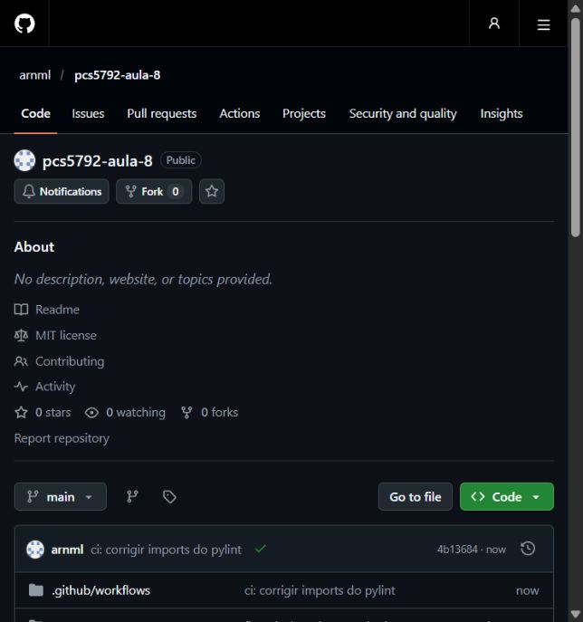
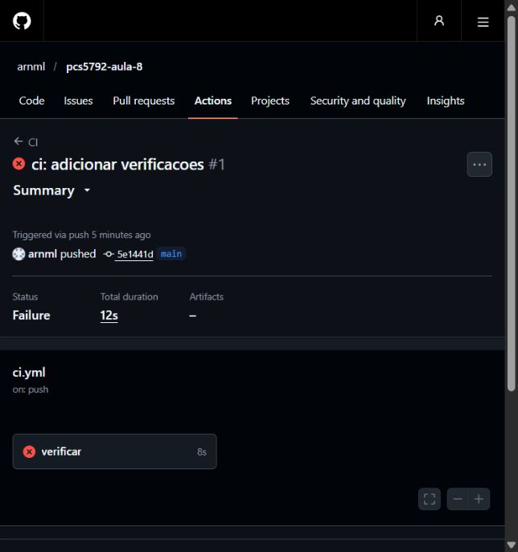
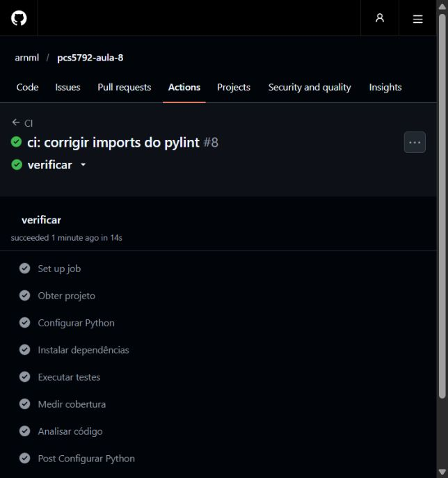

# Aula 8 - Integração contínua

## 1. Projeto e repositório

Descompactei o projeto **simple-maths** e publiquei o código original antes de corrigir os testes. O repositório foi criado na conta `arnml`.



## 2. Primeiro workflow

Adicionei o arquivo [ci.yml](.github/workflows/ci.yml). A cada push ou pull request, o GitHub Actions prepara o Python, instala as dependências e executa, nesta ordem, os testes, a cobertura e o Pylint.

```yaml
- name: Executar testes
  run: python -m unittest discover -s tests -v
- name: Medir cobertura
  run: |
    coverage run --source=src -m unittest discover -s tests
    coverage report -m
```

A primeira execução apresentou **quatro falhas** entre 196 testes. Além disso, três testes já estavam marcados no projeto como falhas esperadas. Quando os testes falham, o Actions interrompe as etapas seguintes.



[Abrir a primeira execução](https://github.com/arnml/pcs5792-aula-8/actions/runs/45180804229)

## 3. Correções dos testes

Fiz cada correção em um commit separado e acompanhei as novas execuções do Actions.

### Contagem de dígitos

O teste esperava que zero tivesse um dígito, mas a função retornava zero. Ajustei o caso especial:

```python
if n == 0:
    return 1
```

### Verificação de números primos

O número zero era tratado como primo. Passei a rejeitar os valores menores ou iguais a um:

```python
if num <= 1:
    return False
```

### Fatores primos e totiente

A lista de fatores não incluía o número restante quando ele próprio era primo. Isso também fazia o totiente de um número primo ficar incorreto. Acrescentei o fator restante:

```python
if num > 1:
    factors.append(num)
```

Essa alteração resolveu os testes de fatores primos e de totiente. Por exemplo, os fatores de 13 passaram a ser `[13]` e seu totiente passou a ser 12.

### Falhas esperadas

O projeto também tinha três testes com `@unittest.expectedFailure`. Corrigi os comportamentos e retirei essas marcações para que os testes voltassem a ser verificações comuns:

- **Norma L2:** acrescentei a raiz quadrada à soma dos quadrados; para `[3, 4]`, o resultado passou a ser 5.
- **Número de Armstrong:** usei a quantidade de dígitos como expoente; assim, 1634 também é reconhecido.
- **Fórmula quadrática:** corrigi a multiplicação por 4 no discriminante; para `x² - 3x + 2`, as raízes são 1 e 2.

## 4. Cobertura e análise estática

Depois das correções, os testes passaram e o CI chegou à análise estática. O Pylint não encontrava os módulos de `src`, embora os testes adicionassem essa pasta ao caminho de importação. Configurei `PYTHONPATH` na etapa de lint:

```yaml
- name: Analisar código
  env:
    PYTHONPATH: ${{ github.workspace }}/src
  run: pylint --errors-only src tests
```

O `coverage` executou novamente os testes e informou **97% de cobertura** para as instruções incluídas no relatório dessa configuração. Essa medida indica o código executado pelos testes; não garante que todos os casos possíveis estejam corretos.

O Pylint foi configurado com `--errors-only` para verificar erros; avisos de estilo e outras categorias não fazem parte desse resultado. Também atualizei `actions/setup-python` para a versão 6, eliminando um aviso de depreciação da execução inicial.

## 5. Resultado final

Na [execução aprovada](https://github.com/arnml/pcs5792-aula-8/actions/runs/45182341260), os **196 testes passaram**, sem falhas esperadas. As etapas de cobertura e análise estática também passaram.



O histórico completo está na aba [Actions](https://github.com/arnml/pcs5792-aula-8/actions) e nos [commits](https://github.com/arnml/pcs5792-aula-8/commits/main/).

## 6. Experiência

Consegui corrigir os defeitos identificados pelos testes, inclusive os três que já estavam marcados como falhas esperadas. O Actions facilitou a repetição das verificações a cada push e deixou o histórico de falhas e correções visível.

O coverage ajudou a ver quanto do código incluído na medição foi executado. O Pylint apontou um problema de configuração dos imports, que precisou ser diferenciado de um defeito da aplicação. Uma dificuldade foi interpretar as etapas puladas quando os testes falhavam: a cobertura e o lint só começaram a executar depois que a etapa anterior passou.
